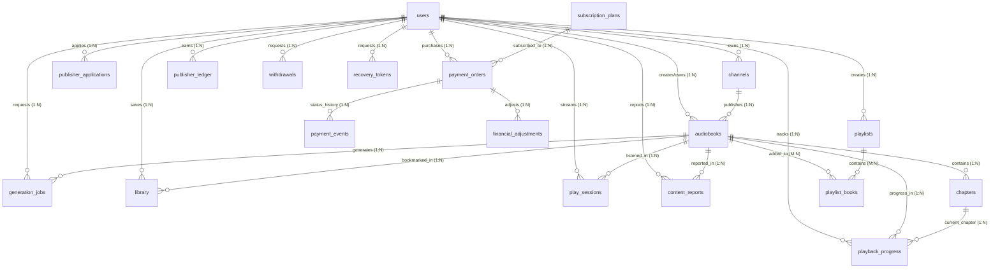

# 📚 BornoVerse — Complete Database Schema & Architectural Guidelines

> **ডাটাবেজ আর্কিটেকচার নির্দেশিকা (PostgreSQL / SQLAlchemy)**  
> এই নথিতে BornoVerse সিস্টেমের সম্পূর্ণ ডাটাবেজ মডেল, টেবিলের ভূমিকা, অ্যাট্রিবিউটসমূহ এবং এনটিটি রিলেশনশিপ (1:1, 1:N, N:M) বিস্তারিতভাবে লিপিবদ্ধ করা হয়েছে।

---

## ১. ডাটাবেজ ওভারভিউ ও আর্কিটেকচারাল মূলনীতি

BornoVerse-এর ব্যাকএন্ড ডেটাবেজ হিসেবে **PostgreSQL** ব্যবহার করা হয়েছে। সিস্টেম ডিজাইনে নিচের ইন্ডাস্ট্রি স্ট্যান্ডার্ড অনুসরণ করা হয়েছে:

1. **UUID Primary Keys**: প্রতিটি মূল টেবিলে গ্লোবালি ইউনিক আইডেন্টিফায়ার হিসেবে `UUIDv4` ব্যবহার করা হয়েছে, যা ডিস্ট্রিবিউটেড সিস্টেম ও মোবাইল অফলাইন সিঙ্ক-এর জন্য সুরক্ষিত।
2. **Strict Timezoning**: প্রতিটি টাইমস্ট্যাম্প `timestamp with time zone (UTC)` হিসেবে সংরক্ষিত।
3. **Auditability & Soft State**: ব্যবহারকারীর অডিও বুকমার্কিং, প্লেব্যাক পজিশন, রয়্যালটি হিসাব এবং এডমিন মডারেশনের জন্য ডেডিকেটেড ট্র্যাকিং টেবিল রয়েছে।
4. **Resilient AI Worker Queue**: ব্যাকগ্রাউন্ড অডিও জেনারেশন (Gemini OCR + TTS)-এর জন্য ডিস্ট্রিবিউটেড লিজ-টোকেন বেসড কিউ টেবিল (`generation_jobs`) রাখা হয়েছে।

---

## ২. সামগ্রিক এনটিটি রিলেশনশিপ ডায়াগ্রাম (ER Diagram)

---

## ৩. মডিউলভিত্তিক বিস্তারিত টেবিল ও অ্যাট্রিবিউট গাইড

---

### মডিউল ১: ইউজার ও আইডেন্টিটি ম্যানেজমেন্ট (User & Identity)

#### ১.১ টেবিল: `users`
- **উদ্দেশ্য**: প্ল্যাটফর্মের শ্রোতা (listener), প্রকাশক (publisher) এবং সিস্টেম অ্যাডমিনদের অ্যাকাউন্ট ক্রেডেনশিয়াল এবং মেম্বারশিপ স্ট্যাটাস সংরক্ষণ করে।
- **Attributes**:

| কলামের নাম | ডেটা টাইপ | কনস্ট্রেইন্ট | বিবরণ |
| :--- | :--- | :--- | :--- |
| `id` | `UUID` | Primary Key | ব্যবহারকারীর ইউনিক আইডি। |
| `username` | `VARCHAR(50)` | NOT NULL, Index | লগইনের ইউজারনেম। |
| `email` | `VARCHAR(255)` | NOT NULL, Index | অ্যাকাউন্টের ইমেইল ঠিকানা। |
| `password_hash` | `VARCHAR(255)` | NOT NULL | আরগন২ / বি-ক্রিপ্ট হ্যাশ করা পাসওয়ার্ড। |
| `full_name` | `VARCHAR(150)` | Nullable | ব্যবহারকারীর পূর্ণ নাম। |
| `account_type` | `VARCHAR(20)` | NOT NULL (Default: `'listener'`) | অ্যাকাউন্টের ধরন: `listener`, `publisher`, `admin`। |
| `publisher_status` | `VARCHAR(40)` | NOT NULL (Default: `'pending_approval'`) | পাবলিশারের অনুমোদন স্ট্যাটাস: `active`, `pending_approval`, `rejected`। |
| `suspended` | `BOOLEAN` | NOT NULL (Default: `false`) | অ্যাকাউন্ট নিষিদ্ধ/সাসপেন্ডেড কিনা। |
| `token_version` | `INTEGER` | NOT NULL (Default: `0`) | পাসওয়ার্ড পরিবর্তন বা ফোর্স লগআউটের সময় রিফ্রেশ টোকেন ইনভ্যালিড করার ভার্সন কাউন্টার। |
| `premium_until` | `TIMESTAMP WITH TZ` | Nullable | প্রিমিয়াম সাবস্ক্রিপশনের মেয়াদ শেষ হওয়ার তারিখ। |
| `subscription_cancelled` | `BOOLEAN` | NOT NULL (Default: `false`) | চলমান সাবস্ক্রিপশন অটো-রিনিউ বাতিল করা হয়েছে কিনা। |
| `created_at` | `TIMESTAMP WITH TZ` | NOT NULL | অ্যাকাউন্ট খোলার সময়। |
| `updated_at` | `TIMESTAMP WITH TZ` | NOT NULL | সর্বশেষ আপডেটের সময়। |

- **Unique Constraints**:
  - `(email, account_type)` — একই ইমেইল দিয়ে একজন ইউজার শ্রোতা এবং প্রকাশক আলাদাভাবে নিবন্ধন করতে পারেন।
  - `(username, account_type)` — ইউজারনেম ইউনিকনেস।

- **সম্পর্ক (Relationships)**:
  - `users (1) ──< (N) audiobooks` [1 to Many]: একজন ইউজারের বহু অডিওবই থাকতে পারে।
  - `users (1) ──< (N) channels` [1 to Many]: একজন প্রকাশকের এক বা একাধিক চ্যানেল থাকতে পারে।
  - `users (1) ──< (N) library` [1 to Many]: একজন ইউজারের সংরক্ষিত লাইব্রেরি আইটেম।
  - `users (1) ──< (N) playback_progress` [1 to Many]: প্লেব্যাকের হিস্ট্রি।
  - `users (1) ──< (N) payment_orders` [1 to Many]: ইউজারের সকল লেনদেন।

---

#### ১.২ টেবিল: `recovery_tokens`
- **উদ্দেশ্য**: পাসওয়ার্ড ভুলে গেলে সুরক্ষিত পাসওয়ার্ড রিসেটের ওয়ান-টাইম সিকিউরিটি টোকেন স্টোর করে।
- **Attributes**:

| কলামের নাম | ডেটা টাইপ | কনস্ট্রেইন্ট | বিবরণ |
| :--- | :--- | :--- | :--- |
| `digest` | `VARCHAR(64)` | Primary Key | সিকিউর SHA-256 টোকেন ডাইজেস্ট। |
| `user_id` | `UUID` | Foreign Key (`users.id`) | যে ইউজারের পাসওয়ার্ড রিসেট হচ্ছে। |
| `expires_at` | `TIMESTAMP WITH TZ` | NOT NULL | টোকেনের মেয়াদোত্তীর্ণের সময় (যেমন: ১৫ মিনিট)। |
| `used` | `BOOLEAN` | NOT NULL (Default: `false`) | টোকেনটি একবার ব্যবহার করা হয়েছে কিনা। |

- **সম্পর্ক (Relationships)**:
  - `users (1) ──< (N) recovery_tokens` [1 to Many]

---

### মডিউল ২: চ্যানেল ও প্রকাশক অপারেশনস (Channels & Publisher Operations)

#### ২.১ টেবিল: `channels`
- **উদ্দেশ্য**: প্রকাশকদের ব্র্যান্ডিং চ্যানেল (যেমন: "সেবা প্রকাশনী", "ঐতিহ্য অডিওবুক") সংরক্ষণ করে।
- **Attributes**:

| কলামের নাম | ডেটা টাইপ | কনস্ট্রেইন্ট | বিবরণ |
| :--- | :--- | :--- | :--- |
| `id` | `UUID` | Primary Key | চ্যানেলের ইউনিক আইডি। |
| `owner_id` | `UUID` | Foreign Key (`users.id`) | চ্যানেলের মালিক পাবলিশার। |
| `name` | `VARCHAR(150)` | NOT NULL | চ্যানেলের প্রদর্শিত নাম। |
| `description` | `TEXT` | Nullable | চ্যানেল সম্পর্কিত বিবরণ। |
| `moderated` | `BOOLEAN` | NOT NULL (Default: `false`) | চ্যানেলটি অ্যাডমিন দ্বারা ভেরিফাইড কিনা। |
| `created_at` | `TIMESTAMP WITH TZ` | NOT NULL | চ্যানেল তৈরির তারিখ। |
| `updated_at` | `TIMESTAMP WITH TZ` | NOT NULL | চ্যানেল আপডেটের তারিখ। |

- **সম্পর্ক (Relationships)**:
  - `users (1) ──< (N) channels` [1 to Many]
  - `channels (1) ──< (N) audiobooks` [1 to Many]: চ্যানেলের অধীনে প্রকাশিত বই।

---

#### ২.২ টেবিল: `publisher_applications`
- **উদ্দেশ্য**: সাধারণ শ্রোতাদের প্রকাশক হওয়ার আবেদনপত্র এবং জাতীয় পরিচয়পত্র/ট্রেড লাইসেন্স ডকুমেন্ট যাচাইয়ের রেকর্ড।
- **Attributes**:

| কলামের নাম | ডেটা টাইপ | কনস্ট্রেইন্ট | বিবরণ |
| :--- | :--- | :--- | :--- |
| `id` | `UUID` | Primary Key | আবেদনের ইউনিক আইডি। |
| `user_id` | `UUID` | Foreign Key (`users.id`) | আবেদনকারী ইউজার। |
| `legal_name` | `VARCHAR(150)` | NOT NULL | প্রকাশনী বা ব্যক্তির অফিশিয়াল নাম। |
| `document_key` | `VARCHAR(1024)` | NOT NULL | আপলোড করা ভেরিফিকেশন ফাইলের লোকেশন। |
| `status` | `VARCHAR(30)` | NOT NULL (Default: `'pending'`) | স্ট্যাটাস: `pending`, `approved`, `rejected`। |
| `reason` | `TEXT` | Nullable | বাতিল বা অনুমোদনের কারণ/মন্তব্য। |
| `created_at` | `TIMESTAMP WITH TZ` | NOT NULL | আবেদনের সময়। |
| `updated_at` | `TIMESTAMP WITH TZ` | NOT NULL | সিদ্ধান্তের সময়। |

- **সম্পর্ক (Relationships)**:
  - `users (1) ──< (N) publisher_applications` [1 to Many]

---

### মডিউল ৩: অডিওবুক ও কন্টেন্ট স্ট্রাকচার (Audiobook Content)

#### ৩.১ টেবিল: `audiobooks`
- **উদ্দেশ্য**: প্ল্যাটফর্মের কেন্দ্রীয় অডিওবুক মেটাডাটা, এক্সেস লেভেল এবং প্রকাশনার অবস্থা সংরক্ষণ করে।
- **Attributes**:

| কলামের নাম | ডেটা টাইপ | কনস্ট্রেইন্ট | বিবরণ |
| :--- | :--- | :--- | :--- |
| `id` | `UUID` | Primary Key | অডিওবুকের ইউনিক আইডি। |
| `owner_id` | `UUID` | Foreign Key (`users.id`, CASCADE) | অডিওবুকের আপলোডার বা প্রকাশক। |
| `channel_id` | `UUID` | Foreign Key (`channels.id`, Nullable) | যে চ্যানেলের অধীনে প্রকাশিত। |
| `title` | `VARCHAR(255)` | NOT NULL, Index | বইয়ের নাম। |
| `author` | `VARCHAR(255)` | Nullable, Index | মূল লেখকের নাম। |
| `description` | `TEXT` | Nullable | বইয়ের বিস্তারিত ভূমিকা/সংক্ষেপ। |
| `genre` | `VARCHAR(100)` | Nullable | সাহিত্যের ধরন (যেমন: থ্রিলার, সায়েন্স ফিকশন, কবিতা)। |
| `language` | `VARCHAR(10)` | NOT NULL (Default: `'bn'`) | ভাষা কোড (`bn`, `en`)। |
| `cover_image_url` | `VARCHAR(1024)` | Nullable | বইয়ের কভার আর্টের ইমেজ পাথ। |
| `source_file_url` | `VARCHAR(1024)` | Nullable | আপলোড করা মূল PDF পাণ্ডুলিপির পাথ। |
| `audio_url` | `VARCHAR(1024)` | Nullable | সিঙ্গেল-ফাইল অডিওবুক হলে মূল অডিও লিংক। |
| `duration_seconds`| `FLOAT` | NOT NULL (Default: `0.0`) | মোট দৈর্ঘ্য (সেকেন্ডে)। |
| `access_tier` | `VARCHAR(20)` | NOT NULL (Default: `'free'`) | সাবস্ক্রিপশন অ্যাক্সেস: `'free'`, `'premium'`। |
| `publication_status`| `VARCHAR(20)`| NOT NULL (Default: `'draft'`) | প্রকাশনা অবস্থা: `'draft'`, `'published'`, `'archived'`। |
| `status` | `VARCHAR(20)` | NOT NULL (Default: `'PENDING'`) | এআই প্রসেসিং স্ট্যাটাস: `PENDING`, `PROCESSING`, `COMPLETED`, `FAILED`। |
| `visibility` | `VARCHAR(20)` | NOT NULL (Default: `'PRIVATE'`) | ভিজিবিলিটি: `PUBLIC`, `PRIVATE`। |
| `moderated` | `BOOLEAN` | NOT NULL (Default: `false`) | অ্যাডমিন কর্তৃক কন্টেন্ট অডিট পাস করেছে কিনা। |
| `created_at` | `TIMESTAMP WITH TZ` | NOT NULL | তৈরির সময়। |
| `updated_at` | `TIMESTAMP WITH TZ` | NOT NULL | সর্বশেষ আপডেটের সময়। |

- **সম্পর্ক (Relationships)**:
  - `users (1) ──< (N) audiobooks` [1 to Many, onDelete: CASCADE]
  - `channels (1) ──< (N) audiobooks` [1 to Many, onDelete: SET NULL]
  - `audiobooks (1) ──< (N) chapters` [1 to Many, onDelete: CASCADE]: বই ডিলিট হলে অধ্যায়সমূহ স্বয়ংক্রিয়ভাবে মুছে যাবে।
  - `audiobooks (1) ──< (N) generation_jobs` [1 to Many, onDelete: CASCADE]
  - `audiobooks (1) ──< (N) library` [1 to Many, onDelete: CASCADE]

---

#### ৩.২ টেবিল: `chapters`
- **উদ্দেশ্য**: মাল্টি-পেজ বা একাধিক খণ্ডের বইয়ের প্রতিটি অধ্যায়ের অডিও ফাইল, ক্রমানুসার ও দৈর্ঘ্য সংরক্ষণ করে।
- **Attributes**:

| কলামের নাম | ডেটা টাইপ | কনস্ট্রেইন্ট | বিবরণ |
| :--- | :--- | :--- | :--- |
| `id` | `UUID` | Primary Key | অধ্যায়ের ইউনিক আইডি। |
| `audiobook_id` | `UUID` | Foreign Key (`audiobooks.id`, CASCADE) | সংশ্লিষ্ট মূল অডিওবুক। |
| `chapter_number` | `INTEGER` | NOT NULL | অধ্যায়ের ক্রম (যেমন: ১, ২, ৩...)। |
| `title` | `VARCHAR(255)` | NOT NULL | অধ্যায়ের নাম (যেমন: "অধ্যায় ১: সূচনা")। |
| `duration_seconds`| `FLOAT` | NOT NULL (Default: `0.0`) | অধ্যায়ের অডিও দৈর্ঘ্য (সেকেন্ডে)। |
| `audio_url` | `VARCHAR(1024)` | Nullable | উৎপাদিত অধ্যায়ের WAV/MP3 অডিও পাথ। |
| `created_at` | `TIMESTAMP WITH TZ` | NOT NULL | তৈরির সময়। |
| `updated_at` | `TIMESTAMP WITH TZ` | NOT NULL | আপডেটের সময়। |

- **সম্পর্ক (Relationships)**:
  - `audiobooks (1) ──< (N) chapters` [1 to Many, onDelete: CASCADE]
  - `chapters (1) ──< (N) playback_progress` [1 to Many, onDelete: SET NULL]

---

#### ৩.৩ টেবিল: `playlists` এবং `playlist_books`
- **উদ্দেশ্য**: ইউজারের কাস্টম প্লেলিস্ট তৈরি এবং তাতে অডিওবুক অন্তর্ভুক্তকরণ (Many-to-Many রিলেশনশিপ)।
- **Attributes (`playlists`)**:

| কলামের নাম | ডেটা টাইপ | কনস্ট্রেইন্ট | বিবরণ |
| :--- | :--- | :--- | :--- |
| `id` | `UUID` | Primary Key | প্লেলিস্টের ইউনিক আইডি। |
| `user_id` | `UUID` | Foreign Key (`users.id`) | প্লেলিস্টের মালিক। |
| `name` | `VARCHAR(150)` | NOT NULL | প্লেলিস্টের নাম (যেমন: "ভ্রমণকালে শোনার বই")। |
| `created_at` | `TIMESTAMP WITH TZ` | NOT NULL | তৈরির তারিখ। |
| `updated_at` | `TIMESTAMP WITH TZ` | NOT NULL | আপডেটের তারিখ। |

- **Attributes (`playlist_books` - Junction Table)**:

| কলামের নাম | ডেটা টাইপ | কনস্ট্রেইন্ট | বিবরণ |
| :--- | :--- | :--- | :--- |
| `playlist_id` | `UUID` | PK, FK (`playlists.id`, CASCADE) | কোন প্লেলিস্ট। |
| `audiobook_id` | `UUID` | PK, FK (`audiobooks.id`, CASCADE) | কোন অডিওবুক। |

- **সম্পর্ক (Relationships)**:
  - `playlists (N) <──> (M) audiobooks` [Many to Many via `playlist_books`]

---

### মডিউল ৪: এআই প্রসেসিং ও ব্যাকগ্রাউন্ড ওয়ার্কার (AI Generation Pipeline)

#### ৪.১ টেবিল: `generation_jobs`
- **উদ্দেশ্য**: Google Gemini API দিয়ে PDF থেকে OCR টেক্সট রিডিং এবং TTS অডিও সিন্থেসিস করার কাজগুলোকে ট্র্যাক করে। এতে ডিস্ট্রিবিউটেড লিজ-টোকেন লকিং রয়েছে যেন ব্যাকগ্রাউন্ড ওয়ার্কার ক্র্যাশ করলেও কাজ আটকে না থাকে।
- **Attributes**:

| কলামের নাম | ডেটা টাইপ | কনস্ট্রেইন্ট | বিবরণ |
| :--- | :--- | :--- | :--- |
| `id` | `UUID` | Primary Key | জেনারেশন জবের ইউনিক আইডি। |
| `audiobook_id` | `UUID` | Foreign Key (`audiobooks.id`, CASCADE) | যে অডিওবুকের জন্য ভয়েস তৈরি হচ্ছে। |
| `owner_id` | `UUID` | Foreign Key (`users.id`, Nullable) | যে ইউজার জবটি সাবমিট করেছে। |
| `status` | `VARCHAR(20)` | NOT NULL (Default: `'PENDING'`) | জবের বর্তমান অবস্থা: `PENDING`, `PROCESSING`, `COMPLETED`, `FAILED`। |
| `priority` | `INTEGER` | NOT NULL (Default: `0`) | কিউতে অগ্রাধিকার ক্রম (পেইড ইউজাররা উচ্চ প্রায়োরিটি পায়)। |
| `total_pages` | `INTEGER` | NOT NULL (Default: `0`) | PDF-এর মোট পৃষ্ঠার সংখ্যা। |
| `completed_pages`| `INTEGER` | NOT NULL (Default: `0`) | এ পর্যন্ত কতগুলো পৃষ্ঠা সফলভাবে অডিওতে রূপান্তরিত হয়েছে। |
| `attempts` | `INTEGER` | NOT NULL (Default: `0`) | ফেইলিওরের পর পুনরায় চেষ্টার সংখ্যা। |
| `cancelled` | `BOOLEAN` | NOT NULL (Default: `false`) | জবটি বাতিল করা হয়েছে কিনা। |
| `lease_token` | `VARCHAR(64)` | Nullable | বর্তমানে যে ওয়ার্কার প্রসেস করছে তার ইউনিক লক টোকেন। |
| `lease_until` | `TIMESTAMP WITH TZ` | Nullable | ওয়ার্কারের লিজের মেয়াদ (হার্টবিট না দিলে লক ছুটে যায়)। |
| `available_at` | `TIMESTAMP WITH TZ` | Nullable | এক্সপোনেনশিয়াল ব্যাকঅফ ট্রাই করার সময়সূচি। |
| `error_message` | `TEXT` | Nullable | ব্যর্থ হলে ত্রুটির কারণ (Worker Error Logs)। |
| `created_at` | `TIMESTAMP WITH TZ` | NOT NULL | জব কিউতে ঢোকার সময়। |
| `started_at` | `TIMESTAMP WITH TZ` | Nullable | ওয়ার্কার কাজ শুরু করার সময়। |
| `completed_at`| `TIMESTAMP WITH TZ` | Nullable | সফলভাবে শেষ হওয়ার সময়। |

- **সম্পর্ক (Relationships)**:
  - `audiobooks (1) ──< (N) generation_jobs` [1 to Many, onDelete: CASCADE]
  - `users (1) ──< (N) generation_jobs` [1 to Many]

---

### মডিউল ৫: ইউজার লাইব্রেরি ও প্লেব্যাক ট্র্যাকিং (Library & Playback Tracking)

#### ৫.১ টেবিল: `library`
- **উদ্দেশ্য**: ইউজারের ব্যক্তিগত সেভ করা বই (বুকমার্ক/ফেভারিটস)।
- **Attributes**:

| কলামের নাম | ডেটা টাইপ | কনস্ট্রেইন্ট | বিবরণ |
| :--- | :--- | :--- | :--- |
| `id` | `UUID` | Primary Key | লাইব্রেরি এন্ট্রির আইডি। |
| `user_id` | `UUID` | Foreign Key (`users.id`, CASCADE) | ব্যবহারকারী। |
| `audiobook_id` | `UUID` | Foreign Key (`audiobooks.id`, CASCADE) | সংরক্ষিত অডিওবুক। |
| `added_at` | `TIMESTAMP WITH TZ` | NOT NULL | লাইব্রেরিতে যোগ করার সময়। |

- **Unique Constraint**: `(user_id, audiobook_id)` — একই বই এক লাইব্রেরিতে একবারই যুক্ত হবে।
- **সম্পর্ক (Relationships)**:
  - `users (1) ──< (N) library` [1 to Many]
  - `audiobooks (1) ──< (N) library` [1 to Many]

---

#### ৫.২ টেবিল: `playback_progress`
- **উদ্দেশ্য**: ব্যবহারকারী বইটির কোন অধ্যায়ের কত সেকেন্ডে পড়া শেষ করেছেন তা রিয়েল-টাইমে সেভ রাখে, যাতে যেকোনো ডিভাইস থেকে পুনরায় চালু করা যায়।
- **Attributes**:

| কলামের নাম | ডেটা টাইপ | কনস্ট্রেইন্ট | বিবরণ |
| :--- | :--- | :--- | :--- |
| `id` | `UUID` | Primary Key | রেকর্ডের ইউনিক আইডি। |
| `user_id` | `UUID` | Foreign Key (`users.id`, CASCADE) | ব্যবহারকারী। |
| `audiobook_id` | `UUID` | Foreign Key (`audiobooks.id`, CASCADE) | যে বই শুনছেন। |
| `chapter_id` | `UUID` | Foreign Key (`chapters.id`, SET NULL) | চলমান অধ্যায়। |
| `position_seconds`| `FLOAT` | NOT NULL (Default: `0.0`) | বর্তমান প্লেব্যাক সময় (সেকেন্ডে)। |
| `updated_at` | `TIMESTAMP WITH TZ` | NOT NULL | সর্বশেষ শোনার সময়। |

- **Unique Constraint**: `(user_id, audiobook_id)` — প্রতি বইয়ের জন্য ইউজারের একটিভ পজিশন থাকে।
- **সম্পর্ক (Relationships)**:
  - `users (1) ──< (N) playback_progress` [1 to Many]
  - `audiobooks (1) ──< (N) playback_progress` [1 to Many]
  - `chapters (1) ──< (N) playback_progress` [1 to Many]

---

#### ৫.৩ টেবিল: `play_sessions` এবং `eligible_views`
- **উদ্দেশ্য**: প্রকাশকদের রয়্যালটি দেওয়ার জন্য ভিউ কাউন্ট ও ভেরিফাইড প্লে-টাইম অডিট রেকর্ড।
- **Attributes (`play_sessions`)**:
  - `id`: `UUID` (PK)
  - `user_id`: `UUID` (FK `users.id`)
  - `audiobook_id`: `UUID` (FK `audiobooks.id`)
  - `seconds`: `INTEGER` (মোট কত সেকেন্ড শুনেছেন)
  - `eligible`: `BOOLEAN` (রয়্যালটি পাওয়ার মতো লিসেনিং কিনা)
  - `started_at`, `last_heartbeat`: `TIMESTAMP WITH TZ`

---

### মডিউল ৬: সাবস্ক্রিপশন, পেমেন্ট ও রয়্যালটি লেজার (Billing & Finance)

#### ৬.১ টেবিল: `subscription_plans`
- **উদ্দেশ্য**: প্রিমিয়াম মেম্বারশিপ প্যাকেজ (যেমন: ১ মাস, ৬ মাস, ১ বছর)।
- **Attributes**:

| কলামের নাম | ডেটা টাইপ | কনস্ট্রেইন্ট | বিবরণ |
| :--- | :--- | :--- | :--- |
| `id` | `UUID` | Primary Key | প্ল্যানের আইডি। |
| `name` | `VARCHAR(100)` | NOT NULL | প্যাকেজের নাম (যেমন: "মাসিক প্রিমিয়াম")। |
| `months` | `INTEGER` | NOT NULL | মেয়াদের মাস সংখ্যা (যেমন: ১, ৬, ১২)। |
| `price` | `NUMERIC(14, 2)`| NOT NULL | মূল্য (BDT তে)। |
| `active` | `BOOLEAN` | NOT NULL (Default: `true`) | প্যাকেজটি চালু আছে কিনা। |
| `created_at` | `TIMESTAMP WITH TZ` | NOT NULL | তৈরির সময়। |
| `updated_at` | `TIMESTAMP WITH TZ` | NOT NULL | আপডেটের সময়। |

---

#### ৬.২ টেবিল: `payment_orders` এবং `payment_events`
- **উদ্দেশ্য**: সাবস্ক্রিপশন কেনার জন্য লেনদেনের অর্ডার ও বিকাশ/নগদ/কার্ড পে-গেটওয়ে ইভেন্ট হিস্ট্রি।
- **Attributes (`payment_orders`)**:

| কলামের নাম | ডেটা টাইপ | কনস্ট্রেইন্ট | বিবরণ |
| :--- | :--- | :--- | :--- |
| `id` | `UUID` | Primary Key | ট্রানজ্যাকশন আইডি। |
| `user_id` | `UUID` | Foreign Key (`users.id`) | ক্রেতা। |
| `plan_id` | `UUID` | Foreign Key (`subscription_plans.id`) | কেনা প্যাকেজ। |
| `kind` | `VARCHAR(30)` | NOT NULL | পেমেন্টের ধরন (`subscription`, `book_purchase`)। |
| `amount` | `NUMERIC(14, 2)`| NOT NULL | মোট পরিশোধিত টাকা। |
| `status` | `VARCHAR(20)` | NOT NULL (Default: `'pending'`) | স্ট্যাটাস (`pending`, `completed`, `failed`)। |
| `idempotency_key`| `VARCHAR(100)` | NOT NULL | ডুপ্লিকেট পেমেন্ট রোধের কি। |
| `provider` | `VARCHAR(20)` | NOT NULL (Default: `'mock'`) | পেমেন্ট মেথড (যেমন: `bkash`, `sslcommerz`)। |
| `created_at` | `TIMESTAMP WITH TZ` | NOT NULL | অর্ডারের সময়। |

- **সম্পর্ক (Relationships)**:
  - `subscription_plans (1) ──< (N) payment_orders` [1 to Many]
  - `payment_orders (1) ──< (N) payment_events` [1 to Many]
  - `payment_orders (1) ──< (N) financial_adjustments` [1 to Many]

---

#### ৬.৩ টেবিল: `publisher_ledger` এবং `withdrawals`
- **উদ্দেশ্য**: রয়্যালটি পুল থেকে প্রকাশকদের মাসিক অর্জিত আয় এবং তা বিকাশ/ব্যাংকে উইথড্র করার ট্রানজ্যাকশন লেজার।
- **Attributes (`publisher_ledger`)**:
  - `id`: `UUID` (PK)
  - `publisher_id`: `UUID` (FK `users.id`)
  - `month`: `VARCHAR(7)` (কোন মাসের আয়, যেমন: `2026-10`)
  - `amount`: `NUMERIC(14, 2)` (টাকার পরিমাণ)
  - `kind`: `VARCHAR(30)` (`royalty`, `adjustment`)
  - `reference`: `VARCHAR(100)` (ইউনিক রেফারেন্স কোড)
- **Attributes (`withdrawals`)**:
  - `id`: `UUID` (PK)
  - `publisher_id`: `UUID` (FK `users.id`)
  - `amount`: `NUMERIC(14, 2)` (উত্তোলনের পরিমাণ)
  - `status`: `VARCHAR(20)` (`pending`, `approved`, `rejected`)
  - `destination`: `VARCHAR(150)` (বিকাশ নম্বর বা ব্যাংক অ্যাকাউন্ট তথ্য)

---

### মডিউল ৭: অ্যাডমিন ও প্ল্যাটফর্ম গভর্নেন্স (Moderation & System Settings)

#### ৭.১ টেবিল: `content_reports`
- **উদ্দেশ্য**: কোনো বইয়ে কপিরাইট বা আপত্তিকর কনটেন্ট থাকলে শ্রোতাদের রিপোর্ট গ্রহণের টেবিল।
- **Attributes**:
  - `id`: `UUID` (PK)
  - `user_id`: `UUID` (FK `users.id`)
  - `audiobook_id`: `UUID` (FK `audiobooks.id`)
  - `reason`: `TEXT` (অভিযোগের বিবরণ)
  - `status`: `VARCHAR(20)` (`open`, `resolved`, `dismissed`)
  - `resolution`: `TEXT` (অ্যাডমিন গৃহীত পদক্ষেপ)

#### ৭.২ টেবিল: `audit_history`
- **উদ্দেশ্য**: অ্যাডমিন বা স্টাফদের প্রতিটি অ্যাকশনের অডিট ট্রেইল (কে কোন বই ব্যান করল বা পেমেন্ট অনুমোদন করল)।
- **Attributes**:
  - `id`: `UUID` (PK)
  - `actor_id`: `UUID` (FK `users.id`, Nullable)
  - `action`: `VARCHAR(100)`
  - `target`: `VARCHAR(100)`
  - `details`: `JSON`
  - `created_at`: `TIMESTAMP WITH TZ`

#### ৭.৩ টেবিল: `platform_settings`
- **উদ্দেশ্য**: প্ল্যাটফর্মের ডায়নামিক পলিসি (যেমন: মাসিক ফ্রি জেনারেশন লিমিট, রয়্যালটি শেয়ার রেশিও)।
- **Attributes**:
  - `key`: `VARCHAR(100)` (PK)
  - `value`: `JSON` (NOT NULL)

---

## ৪. গুরুত্বপূর্ণ রিলেশনশিপ সারাংশ (Summary Table)

| প্যারেন্ট টেবিল (1) | চাইল্ড টেবিল (Many) | কার্ডিনালিটি | ফরেন কি (Foreign Key) | অন-ডিলিট আচরণ (On Delete) | বাস্তব জীবনের সম্পর্ক |
| :--- | :--- | :--- | :--- | :--- | :--- |
| `users` | `audiobooks` | **1 to Many** | `audiobooks.owner_id` | `CASCADE` | একজন প্রকাশক বহু বই তৈরি করতে পারেন। |
| `audiobooks` | `chapters` | **1 to Many** | `chapters.audiobook_id` | `CASCADE` | একটি বইয়ের একাধিক অধ্যায়/পেজ থাকে। |
| `audiobooks` | `generation_jobs` | **1 to Many** | `generation_jobs.audiobook_id` | `CASCADE` | একটি বইয়ের জন্য এআই জেনারেশন রিকোয়েস্ট তৈরি হয়। |
| `users` | `library` | **1 to Many** | `library.user_id` | `CASCADE` | একজন ইউজারের নিজস্ব সেভ করা বুকমার্কে বই থাকে। |
| `users` | `playback_progress`| **1 to Many** | `playback_progress.user_id` | `CASCADE` | ইউজারের প্রতিটি বই শোনার পজিশন থাকে। |
| `chapters` | `playback_progress`| **1 to Many** | `playback_progress.chapter_id` | `SET NULL` | ইউজার বর্তমানে কোন অধ্যায়ে শুনছেন। |
| `playlists` | `audiobooks` | **Many to Many** | `playlist_books` (Junction) | `CASCADE` | একটি প্লেলিস্টে বহু বই, এবং একটি বই বহু প্লেলিস্টে থাকতে পারে। |
| `subscription_plans` | `payment_orders` | **1 to Many** | `payment_orders.plan_id` | `RESTRICT` | একটি প্ল্যানের অধীনে বহু ইউজার অর্ডার করে। |
| `payment_orders` | `payment_events` | **1 to Many** | `payment_events.order_id` | `CASCADE` | একটি অর্ডারের বহু পেমেন্ট ইভেন্ট/ওয়েবহুক থাকে। |

---

## ৫. কীভাবে এই ফাইলটি ব্যবহার করবেন

এই ফাইলটি আপনার প্রজেক্টের **Database Specification & Architecture Document** হিসেবে সরাসরি রিলেভেন্ট।
- **Project Defense / Presentation / Viva**: প্রতিটি টেবিল কেন আছে, কীভাবে ফিল্ডগুলো এআই ও প্লেয়ারের সাথে কাজ করে তা এই ডকুমেন্ট দেখে সরাসরি বুঝিয়ে দেওয়া যাবে।
- **dbdiagram.io Visualization**: এই ডকুমেন্টের সাথে দেওয়া আগের DBML কোড ব্যবহার করে যেকোনো সময় ইন্টারেক্টিভ রিলেশনাল ডায়াগ্রাম এক্সপোর্ট বা প্রিন্ট করতে পারবেন।
